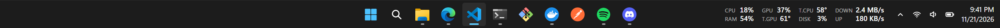
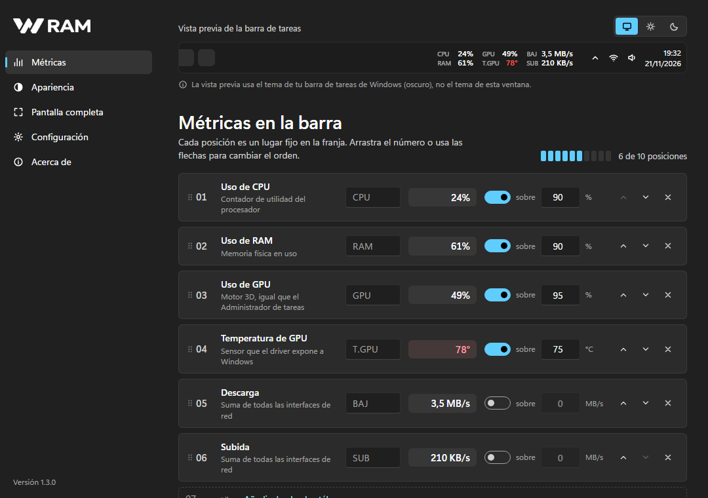
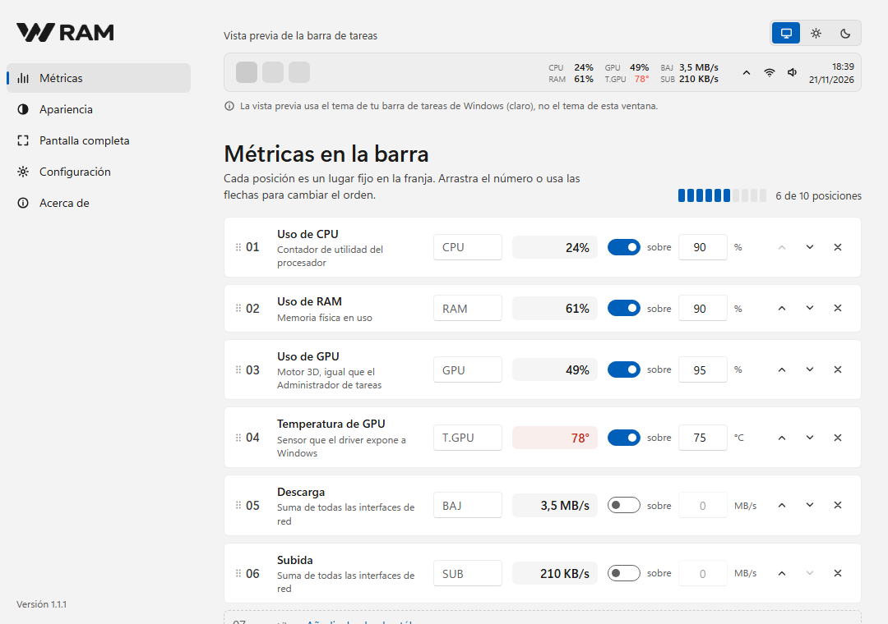
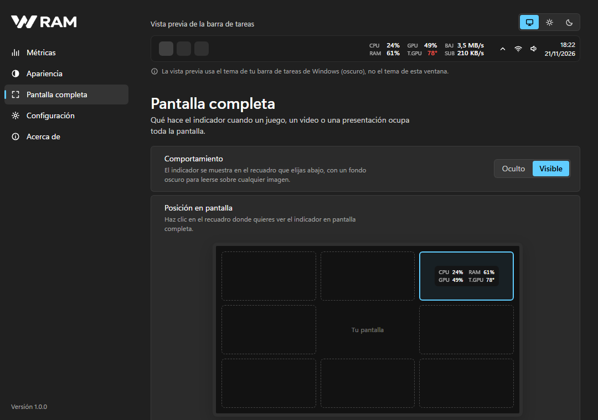
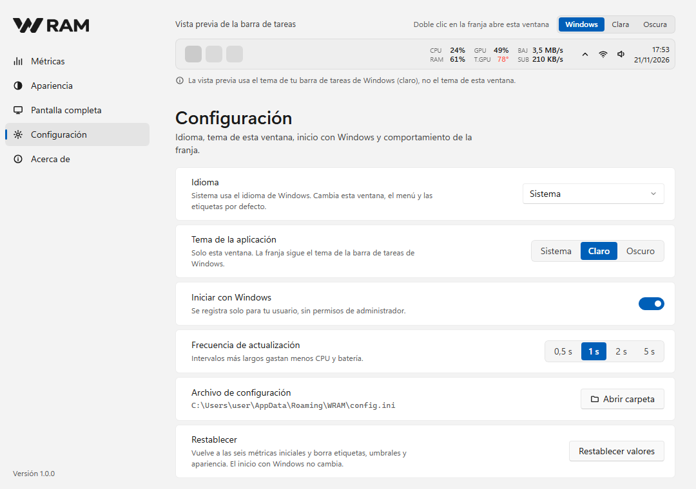

<p align="center">
  <picture>
    <source media="(prefers-color-scheme: dark)" srcset="assets/logo-horizontal-light.png">
    
  </picture>
</p>

<p align="center">
  Monitor del sistema para la barra de tareas de Windows.<br>
  Hasta 10 métricas en vivo junto a la bandeja, en un solo ejecutable de unos 400 KB.
</p>

<p align="center">
  <a href="https://github.com/Ju4nMarin/WRAM/releases/latest">Descargar</a> ·
  <a href="docs/es/instalacion.md">Instalación</a> ·
  <a href="docs/es/uso.md">Uso</a> ·
  <a href="docs/es/arquitectura.md">Arquitectura</a> ·
  <a href="docs/es/desarrollo.md">Desarrollo</a> ·
  <a href="README.md">English</a>
</p>

<p align="center">
  
  
  
  
  
  <br>
  
  
  
  
  
  
  
</p>

<p align="center">
  <a href="https://github.com/Ju4nMarin/WRAM/releases/latest"></a>
  <a href="https://github.com/Ju4nMarin/WRAM/actions/workflows/ci.yml"></a>
  <a href="LICENSE"></a>
  
</p>

## Qué hace

WRAM dibuja una franja de texto a la izquierda de la bandeja del sistema con las métricas que elijas: uso de CPU, RAM y GPU, temperaturas, red, disco, batería y más. Se configura desde una ventana propia en tema claro u oscuro, y los cambios se ven al instante en la barra.

<picture>
  <source media="(prefers-color-scheme: light)" srcset="docs/img/taskbar-light.png">
  
</picture>

- 14 métricas disponibles, hasta 10 a la vez, en una o dos filas.
- Umbral de aviso por métrica: el valor cambia de color al cruzarlo.
- En pantalla completa puede quedar oculta o visible en el recuadro de pantalla que elijas, y reacciona en el acto al entrar y al salir.
- Interfaz en español, inglés, portugués, francés, chino simplificado y japonés.
- Sin permisos de administrador, sin drivers y sin runtime: un solo `WRAM.exe`.
- En reposo usa cerca de 9 MB de memoria y 0,2 % de un núcleo de CPU.





| Pantalla completa | Configuración |
|---|---|
|  |  |

## Métricas

| Métrica | Fuente |
|---|---|
| Uso de CPU | Contador `% Processor Utility`, el mismo del Administrador de tareas |
| Temperatura de CPU | Zona térmica ACPI. Aproximada; en algunas placas no existe y se muestra "sin sensor" |
| Frecuencia de CPU | `Processor Frequency` × `% Processor Performance` |
| Uso de RAM y RAM en uso | `GlobalMemoryStatusEx` |
| Uso de GPU | Contador `GPU Engine`, motor 3D más ocupado |
| Temperatura de GPU | `D3DKMTQueryAdapterInfo`, la lectura que el driver expone a Windows (NVIDIA, AMD o Intel) |
| VRAM en uso | Contador `GPU Adapter Memory` |
| Actividad de disco | Contador `PhysicalDisk`, disco más ocupado |
| Descarga y subida | Contador `Network Interface`, suma de interfaces |
| Batería | `GetSystemPowerStatus` |
| Tiempo encendido y procesos | `GetTickCount64` y contador `System\Processes` |

## Instalación rápida

1. Descarga `WRAM.exe` desde [Releases](https://github.com/Ju4nMarin/WRAM/releases/latest).
2. Muévelo a una carpeta fija, por ejemplo `%LOCALAPPDATA%\Programs\WRAM`.
3. Ejecútalo. La primera vez se abre la configuración.

La guía completa, con requisitos, inicio con Windows y desinstalación, está en [docs/es/instalacion.md](docs/es/instalacion.md).

## Requisitos

| | |
|---|---|
| Sistema | Windows 10 versión 1903 o posterior, o Windows 11 |
| Arquitectura | x64 |
| Ventana de configuración | Microsoft Edge WebView2 Runtime (incluido en Windows 11 y en Windows 10 actualizado) |

## Compilar

Con Visual Studio 2022 o Build Tools (carga de trabajo de C++):

```
build.cmd
```

Deja `build\WRAM.exe` y ejecuta las pruebas. Detalles en [docs/es/desarrollo.md](docs/es/desarrollo.md).

## Documentación

- [Instalación](docs/es/instalacion.md)
- [Uso y configuración](docs/es/uso.md)
- [Arquitectura](docs/es/arquitectura.md)
- [Seguridad](docs/es/seguridad.md)
- [Desarrollo, ramas y commits](docs/es/desarrollo.md)
- [Cómo contribuir](CONTRIBUTING.es.md)
- [Cambios por versión](CHANGELOG.md)

## Autor

Desarrollado por Juan Guillermo Marín Córdoba ([@Ju4nMarin](https://github.com/Ju4nMarin)).

## Licencia

[MIT](LICENSE) © 2026 Juan Guillermo Marín Córdoba.
