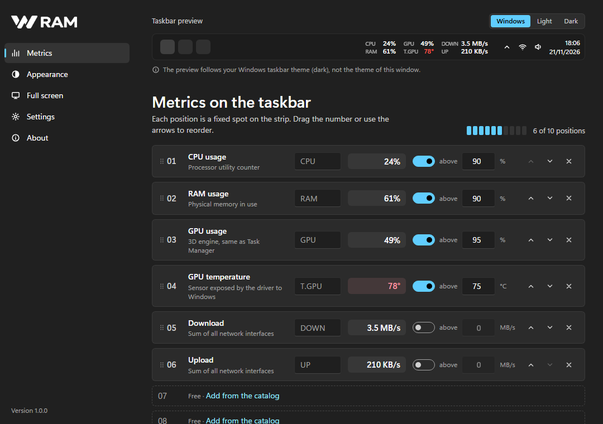
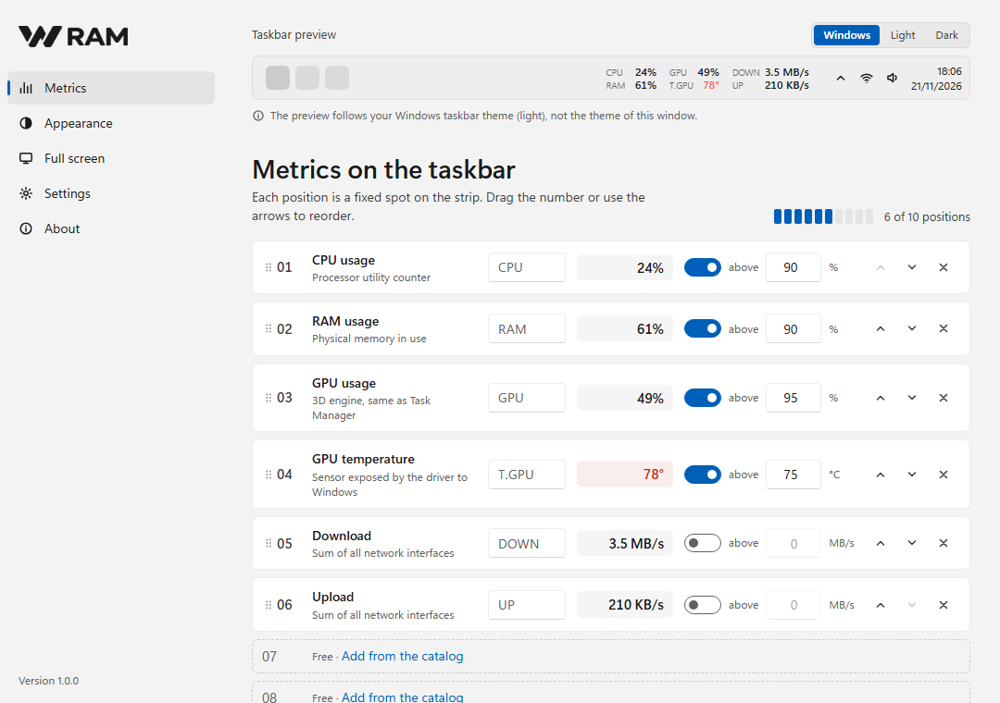
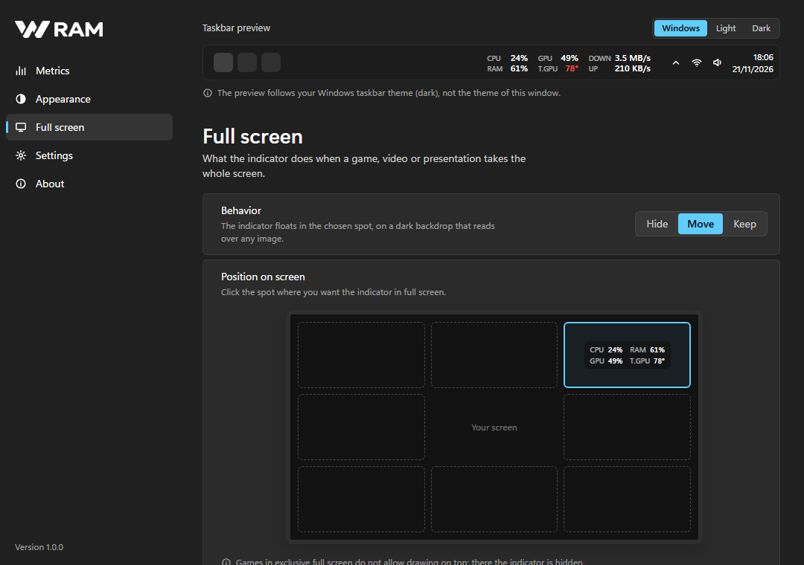
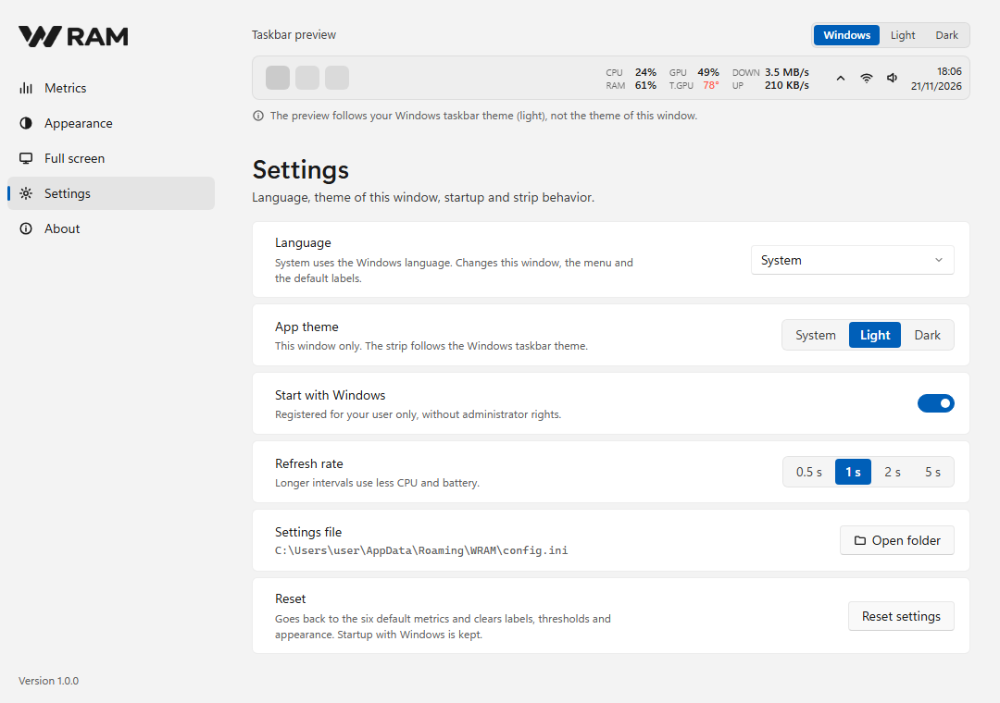

<p align="center">
  <picture>
    <source media="(prefers-color-scheme: dark)" srcset="assets/logo-horizontal-light.png">
    
  </picture>
</p>

<p align="center">
  System monitor for the Windows taskbar.<br>
  Up to 10 live metrics next to the tray, in a single executable of about 400 KB.
</p>

<p align="center">
  <a href="https://github.com/Ju4nMarin/WRAM/releases/latest">Download</a> ·
  <a href="docs/installation.md">Installation</a> ·
  <a href="docs/usage.md">Usage</a> ·
  <a href="docs/architecture.md">Architecture</a> ·
  <a href="docs/development.md">Development</a> ·
  <a href="README.es.md">Español</a>
</p>

<picture>
  <source media="(prefers-color-scheme: light)" srcset="docs/img/taskbar-light.png">
  
</picture>

## What it does

WRAM draws a text strip to the left of the system tray with the metrics you choose: CPU, RAM and GPU usage, temperatures, network, disk, battery and more. It is configured from its own window, in light or dark theme, and every change shows up on the taskbar instantly.

- 14 metrics available, up to 10 at a time, in one or two rows.
- Per-metric alert threshold: the value changes color when it crosses it.
- In full screen it hides, floats in a spot you pick on the screen, or stays put, and reacts instantly when entering and leaving.
- Interface in Spanish, English, Portuguese, French, Simplified Chinese and Japanese.
- No administrator rights, no drivers, no runtime: a single `WRAM.exe`.
- At idle it uses about 9 MB of memory and 0.2% of one CPU core.





| Full screen | Settings |
|---|---|
|  |  |

## Metrics

| Metric | Source |
|---|---|
| CPU usage | `% Processor Utility` counter, the same one Task Manager uses |
| CPU temperature | ACPI thermal zone. Approximate; some motherboards do not expose it and the metric shows "no sensor" |
| CPU clock | `Processor Frequency` × `% Processor Performance` |
| RAM usage and RAM in use | `GlobalMemoryStatusEx` |
| GPU usage | `GPU Engine` counter, busiest 3D engine |
| GPU temperature | `D3DKMTQueryAdapterInfo`, the reading the driver exposes to Windows (NVIDIA, AMD or Intel) |
| VRAM in use | `GPU Adapter Memory` counter |
| Disk activity | `PhysicalDisk` counter, busiest disk |
| Download and upload | `Network Interface` counter, sum of all interfaces |
| Battery | `GetSystemPowerStatus` |
| Uptime and processes | `GetTickCount64` and the `System\Processes` counter |

## Quick install

1. Download `WRAM.exe` from [Releases](https://github.com/Ju4nMarin/WRAM/releases/latest).
2. Move it to a permanent folder, for example `%LOCALAPPDATA%\Programs\WRAM`.
3. Run it. The settings window opens the first time.

The full guide, with requirements, startup with Windows and uninstalling, is in [docs/installation.md](docs/installation.md).

## Requirements

| | |
|---|---|
| System | Windows 10 version 1903 or later, or Windows 11 |
| Architecture | x64 |
| Settings window | Microsoft Edge WebView2 Runtime (included in Windows 11 and in up-to-date Windows 10) |

## Build

With Visual Studio 2022 or Build Tools (C++ desktop workload):

```
build.cmd
```

It produces `build\WRAM.exe` and runs the tests. Details in [docs/development.md](docs/development.md).

## Documentation

- [Installation](docs/installation.md)
- [Usage and settings](docs/usage.md)
- [Architecture](docs/architecture.md)
- [Security](docs/security.md)
- [Development, branches and commits](docs/development.md)
- [Contributing](CONTRIBUTING.md)
- [Changelog](CHANGELOG.md)

Spanish documentation: [README.es.md](README.es.md) and [docs/es](docs/es).

## Author

Developed by Juan Guillermo Marín Córdoba ([@Ju4nMarin](https://github.com/Ju4nMarin)).

## License

[MIT](LICENSE) © 2026 Juan Guillermo Marín Córdoba.
