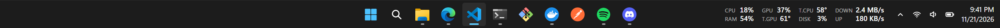
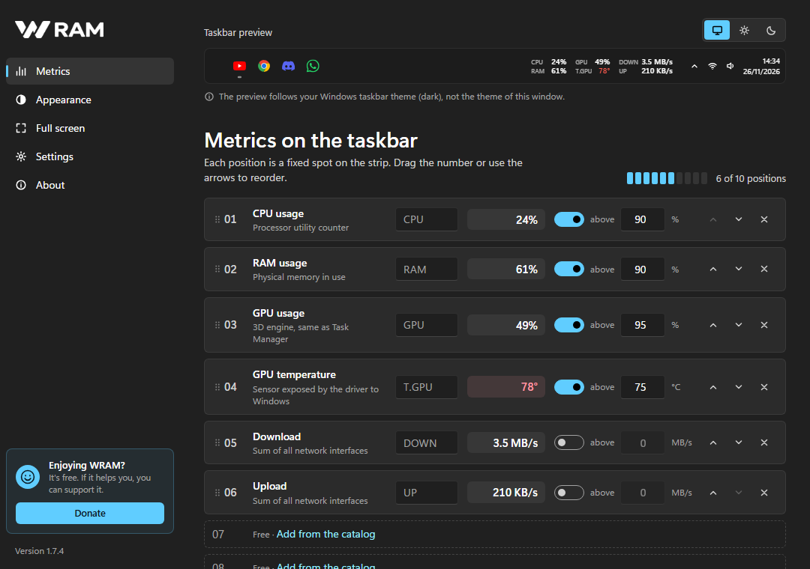
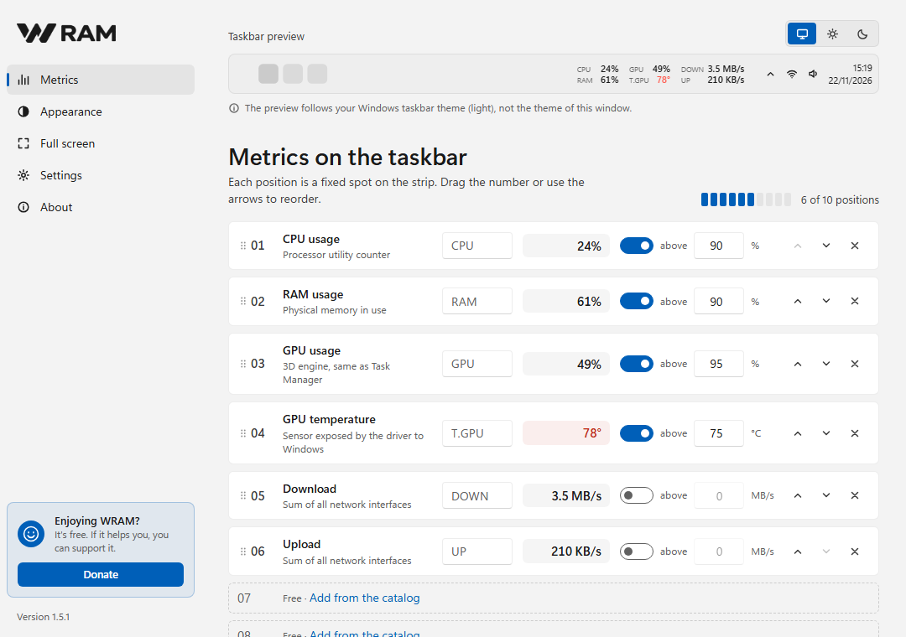
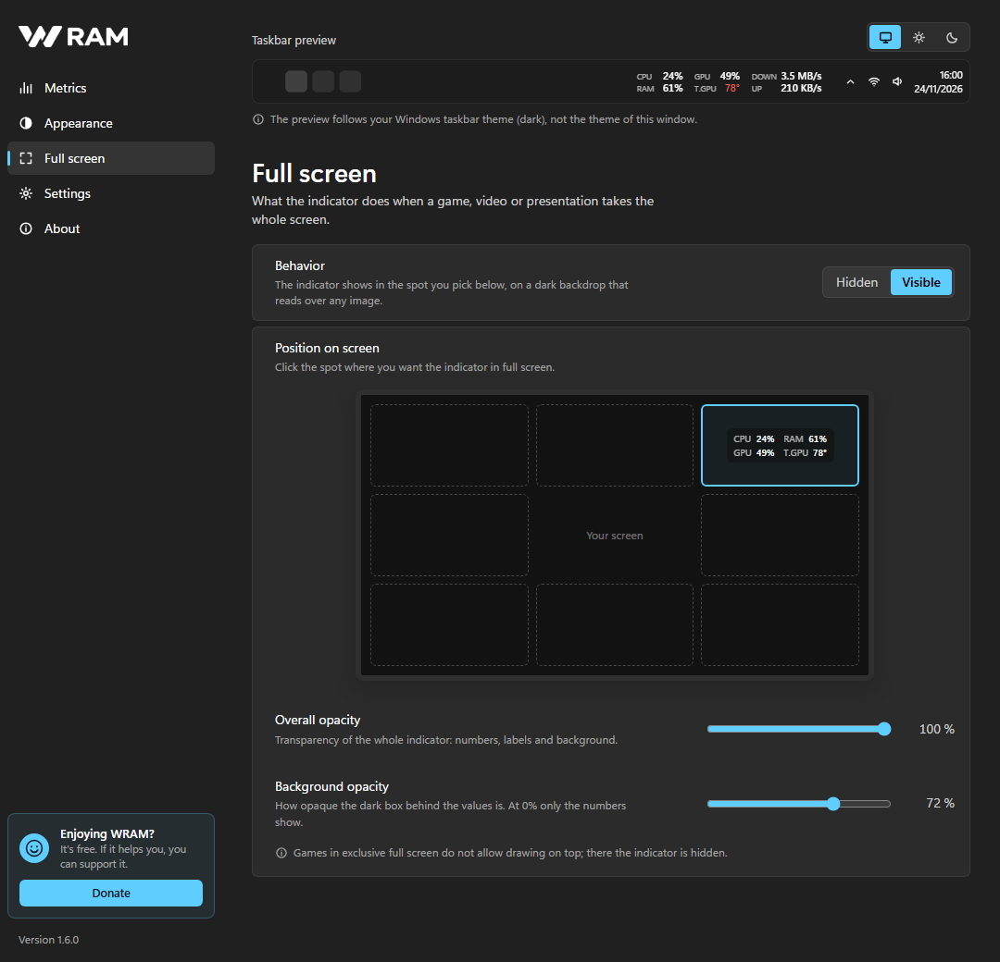
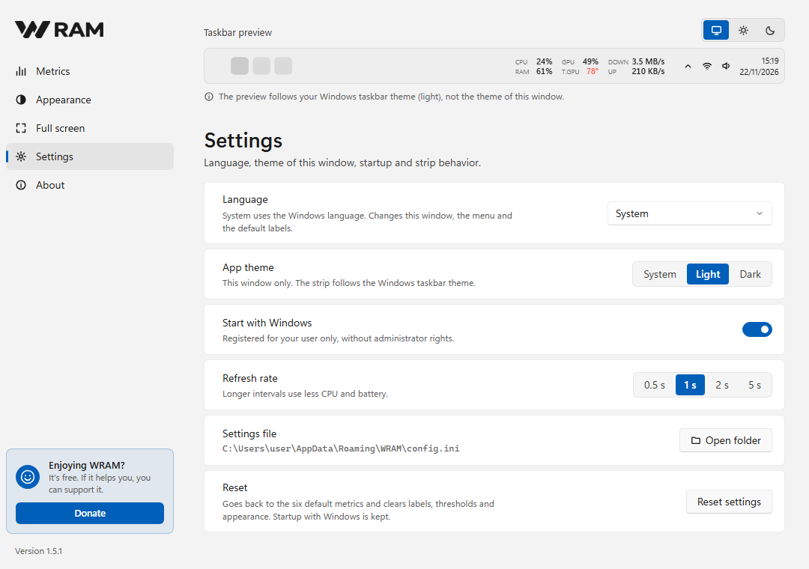

<p align="center">
  <picture>
    <source media="(prefers-color-scheme: dark)" srcset="assets/logo-horizontal-light.png">
    
  </picture>
</p>

<p align="center">
  System monitor for the Windows taskbar.<br>
  Up to 10 live metrics next to the tray, in a single executable of about 430 KB.
</p>

<p align="center">
  <a href="https://github.com/Ju4nMarin/WRAM/releases/latest">Download</a> ·
  <a href="docs/installation.md">Installation</a> ·
  <a href="docs/usage.md">Usage</a> ·
  <a href="docs/architecture.md">Architecture</a> ·
  <a href="docs/development.md">Development</a> ·
  <a href="README.es.md">Español</a>
</p>

<p align="center">
  
  
  
  
  
  <br>
  
  
  
  
  
  
  
</p>

<p align="center">
  <a href="https://github.com/Ju4nMarin/WRAM/releases/latest"></a>
  <a href="https://github.com/Ju4nMarin/WRAM/actions/workflows/ci.yml"></a>
  <a href="LICENSE"></a>
  
  <a href="https://www.paypal.com/paypalme/evopl"></a>
</p>

## What it does

WRAM draws a text strip to the left of the system tray with the metrics you choose: CPU, RAM and GPU usage, temperatures, network, disk, battery and more. It is configured from its own window, in light or dark theme, and every change shows up on the taskbar instantly.

<picture>
  <source media="(prefers-color-scheme: light)" srcset="docs/img/taskbar-light.png">
  
</picture>

- 14 metrics available, up to 10 at a time, in one or two rows.
- Per-metric alert threshold: the value changes color when it crosses it.
- In full screen it can stay hidden or visible in a spot you pick on the screen, and reacts instantly when entering and leaving.
- Interface in Spanish, English, Portuguese, French, Simplified Chinese and Japanese.
- No administrator rights, no drivers, no runtime: a single `WRAM.exe`.
- Updates from the app itself, in Settings: download, SHA-256 verification and restart. A daily check shows a notification when a new version is out.
- At idle it uses about 12 to 17 MB of memory and under 1% of one CPU core.





| Full screen | Settings |
|---|---|
|  |  |

## Metrics

| Metric | Source |
|---|---|
| CPU usage | `% Processor Utility` counter, the same one Task Manager uses |
| CPU temperature | ACPI thermal zone. Approximate; some motherboards do not expose it and the metric shows "no sensor" |
| CPU clock | `Processor Frequency` × `% Processor Performance` |
| RAM usage and RAM in use | `GlobalMemoryStatusEx` |
| GPU usage | `GPU Engine` counter, busiest 3D engine |
| GPU temperature | `D3DKMTQueryAdapterInfo`, the reading the driver exposes to Windows (NVIDIA, AMD or Intel) |
| VRAM in use | `GPU Adapter Memory` counter |
| Disk activity | `PhysicalDisk` counter, busiest disk |
| Download and upload | `Network Interface` counter, sum of all interfaces |
| Battery | `GetSystemPowerStatus` |
| Uptime and processes | `GetTickCount64` and the `System\Processes` counter |

## Quick install

1. Download `WRAM.exe` from [Releases](https://github.com/Ju4nMarin/WRAM/releases/latest).
2. Move it to a permanent folder, for example `%LOCALAPPDATA%\Programs\WRAM`.
3. Run it. The settings window opens the first time.

With [Scoop](https://scoop.sh):

```powershell
scoop install https://github.com/Ju4nMarin/WRAM/releases/latest/download/wram.json
```

The full guide, with requirements, startup with Windows and uninstalling, is in [docs/installation.md](docs/installation.md).

## Requirements

| | |
|---|---|
| System | Windows 10 version 1903 or later, or Windows 11 |
| Architecture | x64 |
| Settings window | Microsoft Edge WebView2 Runtime (included in Windows 11 and in up-to-date Windows 10) |

## Build

With Visual Studio 2022 or Build Tools (C++ desktop workload):

```
build.cmd
```

It produces `build\WRAM.exe` and runs the tests. Details in [docs/development.md](docs/development.md).

## Documentation

- [Installation](docs/installation.md)
- [Usage and settings](docs/usage.md)
- [Architecture](docs/architecture.md)
- [Security](docs/security.md)
- [Development, branches and commits](docs/development.md)
- [Contributing](CONTRIBUTING.md)
- [Changelog](CHANGELOG.md)

Spanish documentation: [README.es.md](README.es.md) and [docs/es](docs/es).

## Support

WRAM is free and open source. If it is useful to you, you can support its development with a donation on [PayPal](https://www.paypal.com/paypalme/evopl). The same link is in the app, in the sidebar and under About.

## Code signing policy

Code signing for Windows releases is handled through the [SignPath Foundation](https://signpath.org) program for open source projects, using [SignPath.io](https://about.signpath.io). Windows releases are built from source by GitHub Actions ([`.github/workflows/ci.yml`](.github/workflows/ci.yml)) from a version tag on `main`, and each signing request is approved manually before the signed `WRAM.exe` is published. Only the executable built from this repository is signed.

Team roles:

| Role | Members |
|---|---|
| Committers and reviewers | [Juan Guillermo Marín Córdoba](https://github.com/Ju4nMarin) |
| Approvers | [Juan Guillermo Marín Córdoba](https://github.com/Ju4nMarin) |

Changes from other contributors go through a pull request reviewed by a committer before they are merged.

Privacy: this program will not transfer any information to other networked systems unless specifically requested by the user or the person installing or operating it. WRAM contacts GitHub (`api.github.com` and `github.com`) only to look for updates: when "Check for updates" is pressed and, with "Notify me about new versions" turned on (the default), at most once a day. It sends no personal data, and the option can be turned off in Settings. The links in the app (source code, license and donation) open in the default browser only when clicked. The settings window uses the Microsoft Edge WebView2 Runtime included in Windows, and its interface is loaded from inside the executable, without remote content.

Third-party components: [THIRD_PARTY_NOTICES.md](THIRD_PARTY_NOTICES.md). The app logos in the settings preview are trademarks of their respective owners, shown only as sample apps.

## Author

Developed by Juan Guillermo Marín Córdoba ([@Ju4nMarin](https://github.com/Ju4nMarin)).

## License

[MIT](LICENSE) © 2026 Juan Guillermo Marín Córdoba.
