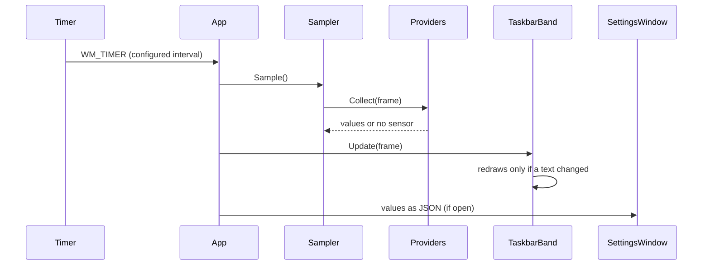

# Architecture

WRAM is a C++17 Win32 application. The taskbar strip is drawn with Direct2D, and the settings window is an HTML file embedded in the executable and shown with WebView2 only while it is open.

## Layers

```
src/
  core/       model without UI dependencies
  platform/   Windows integration (files, registry, RAII)
  sensors/    metric providers
  ui/         strip, tray icon, settings window and its HTML
  app/        composition root
tests/        core tests
```

| Module | Responsibility |
|---|---|
| `core/Metric.h` | `MetricId`, `MetricFrame` (one full reading) and `IMetricProvider` |
| `core/MetricCatalog` | Catalog of the 14 metrics: key, name, source and label in each language, unit, default threshold and alert direction |
| `core/Format` | Text for each value and the widest possible text per unit, with the user's decimal separator |
| `core/Config` | Settings model and `ConfigCodec` (INI to `Config` and back), no I/O |
| `core/I18n` | Active language (Spanish, English, Portuguese, French, Simplified Chinese, Japanese) and native strings |
| `core/Version` | Reading and comparing `X.Y.Z` versions and the `tag_name` field of the GitHub response |
| `platform/ConfigStore` | Atomic read and write of `%APPDATA%\WRAM\config.ini` |
| `platform/Autostart` | Startup with Windows under `HKCU\...\Run` |
| `platform/Updater` | Update check and install from GitHub Releases: WinHTTP, SHA-256 with BCrypt, file swap and restart |
| `sensors/PdhProvider` | CPU, clock, ACPI temperature, GPU, VRAM, disk, network and processes through PDH counters |
| `sensors/GpuThermalProvider` | GPU temperature through `D3DKMTQueryAdapterInfo` |
| `sensors/SystemProviders` | Memory, battery and uptime |
| `sensors/Sampler` | Runs the providers and builds each `MetricFrame` |
| `ui/TaskbarBand` | Strip: position next to the tray (limited by the app icons, read through UI Automation), measuring, drawing and full-screen behavior |
| `ui/TrayIcon` | Notification area icon |
| `ui/SettingsWindow` | WebView2 window, title bar theme and message channel |
| `ui/settings.html` | Settings interface, with its own strings in six languages |
| `app/App` | Creates the pieces, wires events and owns the timer |

## Principles

- Each data source implements `IMetricProvider` (`Provides`, `SetActive`, `Collect`). A new metric is a catalog entry plus, if needed, a new provider registered in `App`; the others do not change.
- Providers open counters only for active metrics. While the settings window is open all metrics are active so the catalog shows live readings.
- The strip and the window depend on interfaces (`IBandEvents`, `ISettingsHost`), not on `App`.
- `ConfigCodec` is pure and owns validation, so it is tested without Windows.

## One reading



The timer is coalescable (`SetCoalescableTimer`), so Windows can batch wake-ups.

## Strip

- Layered window (`WS_EX_LAYERED`) with per-pixel alpha and `UpdateLayeredWindow`. It is drawn with Direct2D in software mode on a 32-bit DIB; for a surface of a few hundred pixels this is cheaper than a GPU device.
- The background has alpha 1/255: invisible, but it still receives clicks.
- It reserves the width of the widest value of each unit so the strip does not resize on every reading.
- It is positioned with `Shell_TrayWnd` and `TrayNotifyWnd`, and follows the scale of the taskbar display (per-monitor DPI v2).
- Full-screen handling (hidden, or visible in one of 8 screen spots on a translucent backdrop) is event driven, without waiting for the timer:
  - `EVENT_SYSTEM_FOREGROUND`: the active window changes.
  - `EVENT_OBJECT_LOCATIONCHANGE` limited to the thread of the active window and re-registered on every focus change: F11 or a video going full screen without a focus change.
  - The active window covers the taskbar monitor and is not a regular maximized window with a title bar. `SHQueryUserNotificationState` covers exclusive Direct3D games and presentations.
  - Measured: it hides in about 35 ms and comes back in about 30 ms.

## Settings window

- The HTML is minified at build time, receives the logos as base64 and is embedded as an `RCDATA` resource.
- WebView2 is created when the window opens and released when it closes; its processes exit and memory goes back to the idle level.
- Messages from the interface: `ready`, `apply\n<ini>`, `reset`, `close` and `open\n<target>`.
- Messages to the interface: `init` (settings, catalog in the active language, theme and limits) and `v` (values and alerts on every reading).
- The interface sends the whole configuration as INI; the program validates it with the same `ConfigCodec` that reads the file.

## Measured usage

Development PC, 6 metrics, 1 s interval:

| State | Memory (working set) | CPU |
|---|---|---|
| Idle | 12 to 17 MB | 0.3% to 0.6% of one core |
| Settings window open | 23 to 27 MB plus 6 WebView2 processes | |
| After closing the settings window | 12 to 13 MB, no WebView2 processes | |

Executable: 516,096 bytes (about 505 KB), with no runtime or extra files.

## Pending

- Per-core CPU temperature, which requires a kernel driver.
- The strip stays below the taskbar while the Start menu or search is open, because Windows raises the taskbar above every other window during that time.
