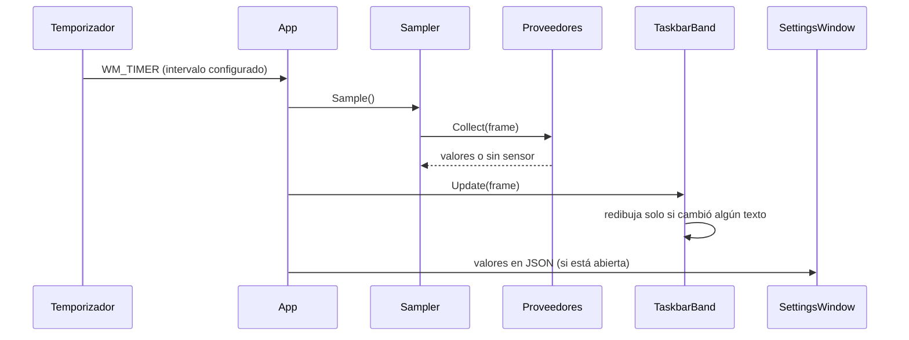

# Arquitectura

WRAM es una aplicación Win32 en C++17. La franja de la barra se dibuja con Direct2D y la ventana de configuración es un HTML incrustado en el ejecutable que se muestra con WebView2 solo mientras está abierta.

## Capas

```
src/
  core/       modelo sin dependencias de interfaz
  platform/   integración con Windows (archivos, registro, RAII)
  sensors/    proveedores de métricas
  ui/         franja, ícono de bandeja, ventana de configuración y su HTML
  app/        raíz de composición
tests/        pruebas del núcleo
```

| Módulo | Responsabilidad |
|---|---|
| `core/Metric.h` | `MetricId`, `MetricFrame` (una lectura completa) e `IMetricProvider` |
| `core/MetricCatalog` | Catálogo de las 14 métricas: clave, nombre, fuente y etiqueta en cada idioma, unidad, umbral por defecto y si avisa por encima o por debajo |
| `core/Format` | Texto de cada valor y texto más ancho posible por unidad, con el separador decimal del usuario |
| `core/Config` | Modelo de configuración y `ConfigCodec` (INI a `Config` y de vuelta), sin E/S |
| `core/I18n` | Idioma activo (español, inglés, portugués, francés y chino simplificado) y textos de la parte nativa |
| `platform/ConfigStore` | Lectura y escritura atómica de `%APPDATA%\WRAM\config.ini` |
| `platform/Autostart` | Inicio con Windows en `HKCU\...\Run` |
| `sensors/PdhProvider` | CPU, frecuencia, temperatura ACPI, GPU, VRAM, disco, red y procesos con contadores PDH |
| `sensors/GpuThermalProvider` | Temperatura de GPU con `D3DKMTQueryAdapterInfo` |
| `sensors/SystemProviders` | Memoria, batería y tiempo encendido |
| `sensors/Sampler` | Orquesta los proveedores y arma cada `MetricFrame` |
| `ui/TaskbarBand` | Franja: posición junto a la bandeja, medición, dibujo y ocultado en pantalla completa |
| `ui/TrayIcon` | Ícono del área de notificación |
| `ui/SettingsWindow` | Ventana con WebView2, tema de la barra de título y canal de mensajes |
| `ui/settings.html` | Interfaz de configuración |
| `app/App` | Crea las piezas, conecta eventos y maneja el temporizador |

## Principios

- Cada fuente de datos implementa `IMetricProvider` (`Provides`, `SetActive`, `Collect`). Una métrica nueva es una entrada en el catálogo y, si hace falta, un proveedor nuevo registrado en `App`; los demás no cambian.
- Los proveedores abren contadores solo para las métricas activas. Con la configuración abierta se activan todas para mostrar el catálogo en vivo.
- La franja y la ventana dependen de interfaces (`IBandEvents`, `ISettingsHost`), no de `App`.
- `ConfigCodec` es puro y concentra la validación, por eso se prueba sin Windows.

## Flujo de una lectura



El temporizador es coalescente (`SetCoalescableTimer`), así Windows puede agrupar despertares.

## Franja

- Ventana por capas (`WS_EX_LAYERED`) con alfa por píxel y `UpdateLayeredWindow`. Se dibuja con Direct2D en modo software sobre un DIB de 32 bits; para una superficie de pocos cientos de píxeles es más barato que un dispositivo de GPU.
- El fondo tiene alfa 1/255: es invisible pero recibe clics.
- Reserva el ancho del valor más largo de cada unidad para que la franja no cambie de tamaño con cada lectura.
- Se ubica con `Shell_TrayWnd` y `TrayNotifyWnd`, y sigue la escala de la pantalla de la barra (DPI por monitor v2).
- Ocultado en pantalla completa por eventos, sin esperar al temporizador:
  - `EVENT_SYSTEM_FOREGROUND`: cambio de ventana activa.
  - `EVENT_OBJECT_LOCATIONCHANGE` de la ventana activa: F11 o un video que pasa a pantalla completa sin cambiar el foco.
  - Una ventana activa cubre el monitor de la barra y no es una ventana maximizada con título. Se suma `SHQueryUserNotificationState` para juegos Direct3D exclusivos y presentaciones.
  - Medido: se oculta en unos 35 ms y reaparece en unos 30 ms.

## Ventana de configuración

- El HTML se minifica en el build, recibe los logos en base64 y se incrusta como recurso `RCDATA`.
- WebView2 se crea al abrir la ventana y se libera al cerrarla; sus procesos terminan y la memoria vuelve a la de reposo.
- Mensajes de la interfaz al programa: `ready`, `apply\n<ini>`, `reset`, `close` y `open\n<destino>`.
- Mensajes del programa a la interfaz: `init` (configuración, catálogo, tema y límites) y `v` (valores y alertas en cada lectura).
- La interfaz manda la configuración completa como INI; el programa la valida con el mismo `ConfigCodec` que lee el archivo.

## Consumo medido

Equipo de desarrollo, 6 métricas, intervalo de 1 s:

| Estado | Memoria (working set) | CPU |
|---|---|---|
| En reposo | 9,4 MB | 47 ms cada 20 s (0,23 % de un núcleo) |
| Configuración abierta | 26 MB más los procesos de WebView2 | |
| Tras cerrar la configuración | 9,0 MB, sin procesos de WebView2 | 47 ms cada 20 s |

## Pendiente

- Barra de tareas vertical y barras de monitores secundarios.
- Temperatura de CPU por núcleo, que requiere un driver de kernel.
