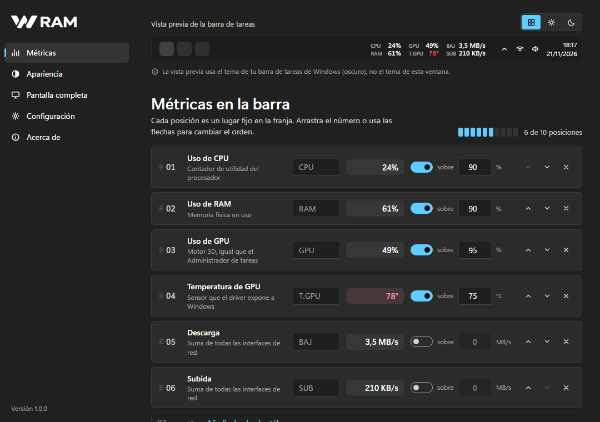
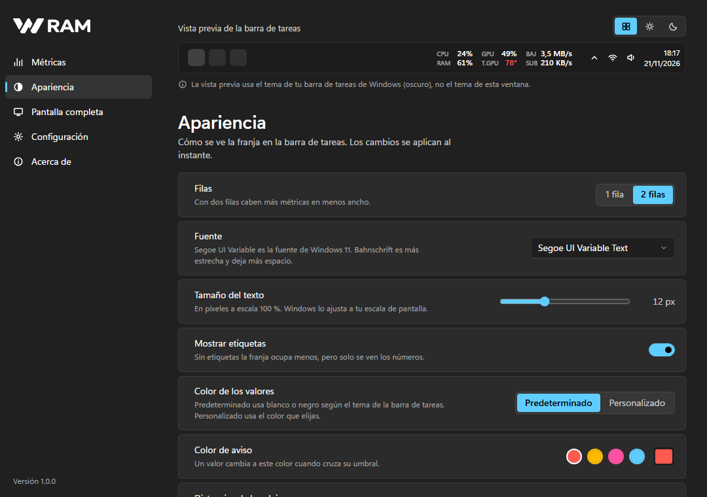
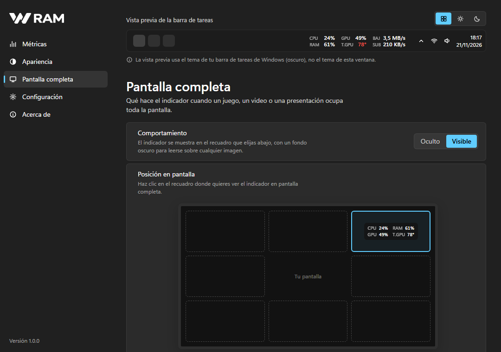
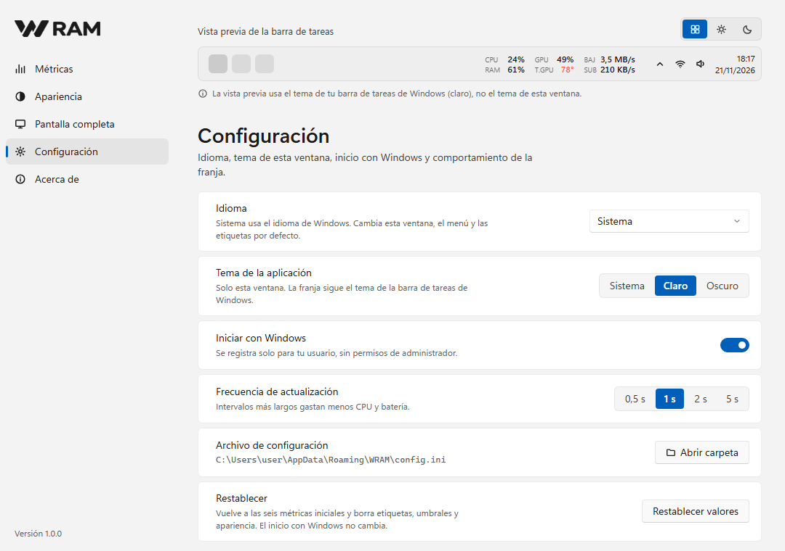

# Uso y configuración

## La franja

La franja se ubica a la izquierda de la bandeja del sistema, en la barra de tareas principal.

| Acción | Resultado |
|---|---|
| Doble clic en la franja | Abre la configuración |
| Clic en el ícono de WRAM en la bandeja | Abre la configuración |
| Clic derecho en la franja o en el ícono | Menú con Configuración y Salir de WRAM |
| Ejecutar `WRAM.exe` otra vez | Abre la configuración de la instancia que ya corre |

Los valores usan blanco o negro según el tema de la barra de tareas, y el separador decimal de tu configuración regional. Una métrica sin sensor en el equipo muestra un guion.

La vista previa de la ventana de configuración reproduce la barra con el tema de la barra de tareas de Windows, que puede ser distinto del tema elegido para la ventana. Lo indica la nota debajo de la vista previa. Los tres botones con ícono junto a la vista previa (Windows, clara y oscura) muestran la franja con el tema de la barra de Windows o sobre una barra clara u oscura para comparar; no cambian ningún ajuste.

## Ventana de configuración

### Métricas



- La lista muestra las 10 posiciones de la franja. Las ocupadas tienen la métrica, su etiqueta, la lectura actual, el umbral y los controles de orden.
- El orden se cambia arrastrando el número de la posición o con las flechas.
- La etiqueta es el texto corto que aparece antes del valor (hasta 8 caracteres). Vacía usa la etiqueta por defecto.
- El interruptor de aviso activa el umbral. Al cruzarlo, el valor cambia al color de aviso. La batería avisa cuando baja del umbral; el resto, cuando lo supera. En descarga y subida el umbral va en MB/s.
- El catálogo, debajo, lista las métricas libres con su lectura actual y el botón para añadirlas.

### Apariencia



| Ajuste | Valores |
|---|---|
| Filas | 1 o 2 |
| Fuente | Segoe UI Variable Text, Bahnschrift, Segoe UI, Cascadia Mono, Consolas |
| Tamaño del texto | 9 a 18 px a escala 100 % |
| Mostrar etiquetas | Sí o no |
| Color de los valores | Predeterminado (blanco o negro según la barra) o personalizado |
| Color de aviso | Rojo, amarillo, magenta, azul u otro color |
| Distancia a la bandeja | 0 a 600 px |

### Pantalla completa



Qué hace la franja cuando un juego, un video o una presentación ocupa toda la pantalla. Reacciona en el acto al entrar y al salir, también con F11 en el navegador.

| Comportamiento | Resultado |
|---|---|
| Oculto | La franja se oculta mientras haya algo en pantalla completa y vuelve al salir |
| Visible | La franja se muestra en el recuadro que elijas de la pantalla, con un fondo oscuro translúcido |

Con Visible, el monitor de ejemplo tiene 8 recuadros (esquinas, centros de los bordes superior e inferior y centros laterales); se elige con un clic. Los juegos en pantalla completa exclusiva no permiten otras ventanas encima, así que ahí la franja siempre se oculta.

### Configuración



| Ajuste | Descripción |
|---|---|
| Idioma | Sistema, español, inglés, portugués, francés, chino simplificado o japonés. Cambia la ventana, el menú y las etiquetas por defecto |
| Tema de la aplicación | Sistema, claro u oscuro. Solo afecta a esta ventana; la franja y la vista previa siguen el tema de la barra de tareas de Windows |
| Iniciar con Windows | Registro en `HKCU\...\Run`, sin administrador |
| Frecuencia de actualización | 0,5, 1, 2 o 5 segundos |
| Archivo de configuración | Ruta de `config.ini` y botón para abrir su carpeta |
| Restablecer | Vuelve a las seis métricas iniciales, con confirmación |

### Acerca de

Versión, autor, licencia, enlace al código fuente, compatibilidad y el origen de cada dato.

## Archivo de configuración

`%APPDATA%\WRAM\config.ini`, en UTF-8. Se puede editar a mano con WRAM cerrado; lo que no es válido se ignora y se ajusta a los rangos permitidos.

```ini
[general]
interval=1000
rows=2
font=Segoe UI Variable Text
fontSize=12
valueColor=auto
alertColor=#ff5a4e
labels=1
autostart=0
fullscreen=0
overlayPos=2
offset=8
theme=0
lang=0

[slots]
1=cpu||90|1
2=ram||90|1
3=gpu||95|1
4=gputemp||80|1
5=netdown||0|0
6=netup||0|0
```

`theme`: 0 sistema, 1 claro, 2 oscuro. `lang`: 0 sistema, 1 español, 2 inglés, 3 portugués, 4 francés, 5 chino simplificado, 6 japonés. `fullscreen`: 0 oculto, 1 visible. `overlayPos`: 0 arriba izquierda, 1 arriba centro, 2 arriba derecha, 3 centro izquierda, 4 centro derecha, 5 abajo izquierda, 6 abajo centro, 7 abajo derecha.

Cada posición sigue el formato `clave|etiqueta|umbral|aviso`.

| Clave | Métrica |
|---|---|
| `cpu` | Uso de CPU |
| `cputemp` | Temperatura de CPU |
| `cpuclock` | Frecuencia de CPU |
| `ram` | Uso de RAM |
| `ramused` | RAM en uso |
| `gpu` | Uso de GPU |
| `gputemp` | Temperatura de GPU |
| `vram` | VRAM en uso |
| `disk` | Actividad de disco |
| `netdown` | Descarga |
| `netup` | Subida |
| `battery` | Batería |
| `uptime` | Tiempo encendido |
| `procs` | Procesos |
