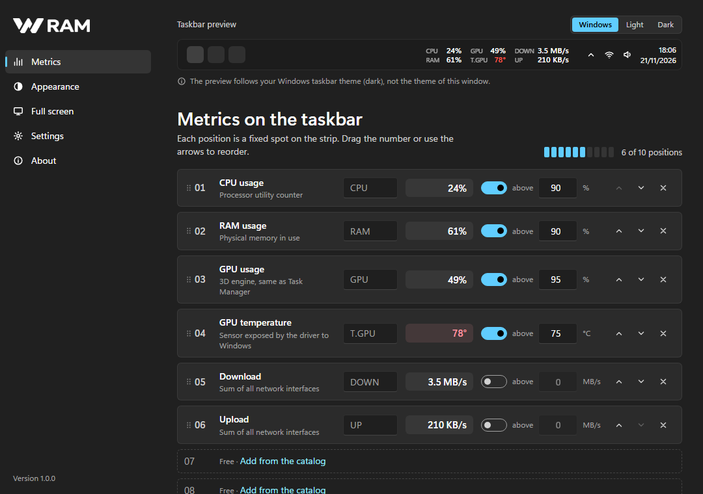
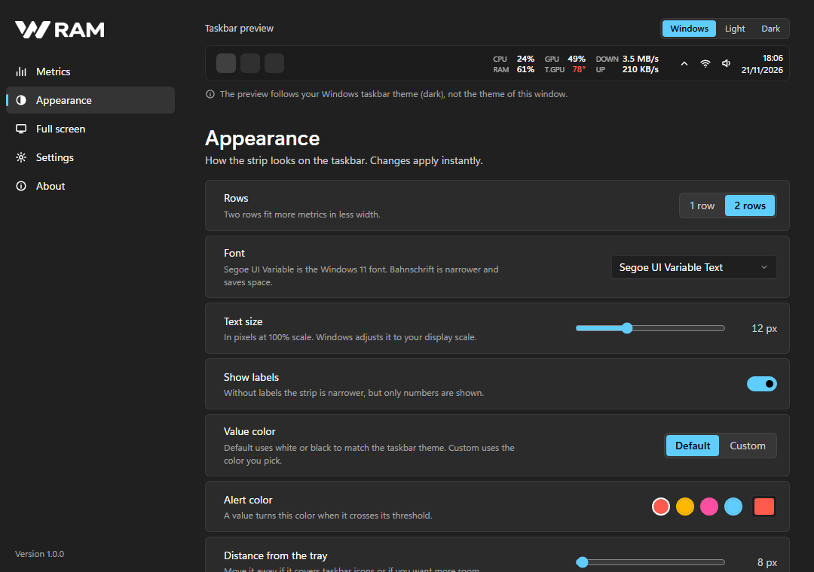
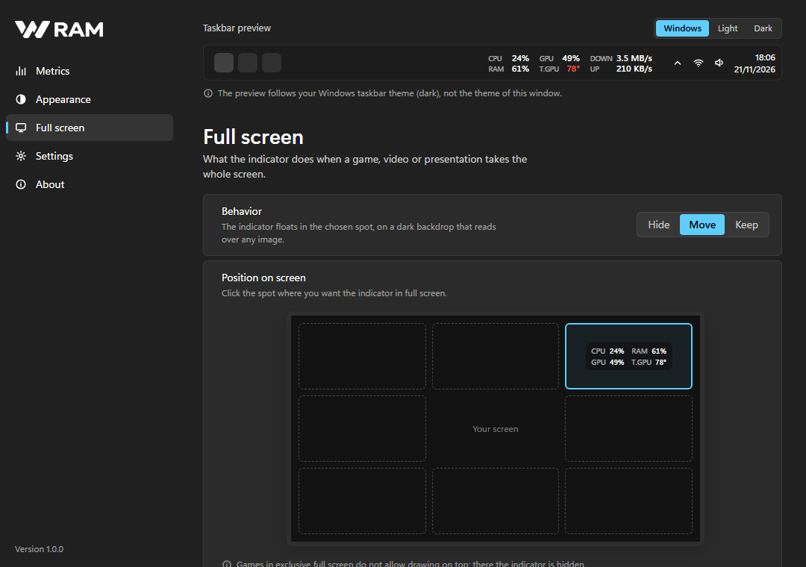
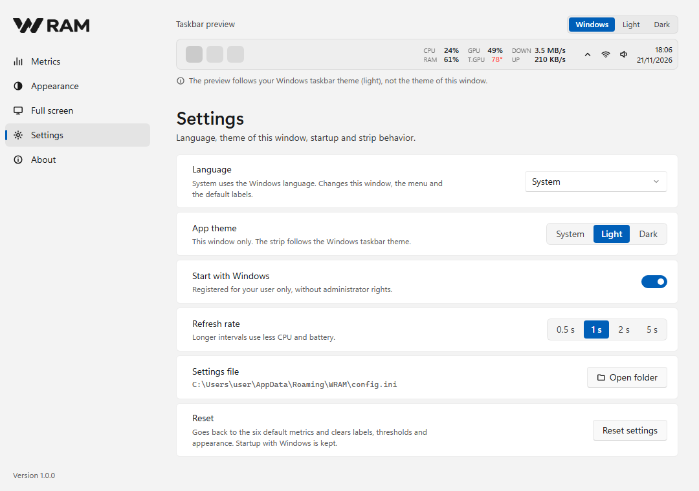

# Usage and settings

## The strip

The strip sits to the left of the system tray, on the main taskbar.

| Action | Result |
|---|---|
| Double-click the strip | Opens the settings window |
| Click the WRAM tray icon | Opens the settings window |
| Right-click the strip or the icon | Menu with Settings and Exit WRAM |
| Run `WRAM.exe` again | Opens the settings window of the running instance |

Values are white or black to match the taskbar theme, and use the decimal separator of your regional settings. A metric without a sensor on the PC shows a dash.

The preview at the top of the settings window reproduces the taskbar with the Windows taskbar theme, which can be different from the theme chosen for the window. The note below the preview says which one is in use. The Windows / Light / Dark selector next to the preview shows the strip on a light or dark taskbar for comparison; it does not change any setting.

## Settings window

### Metrics



- The list shows the 10 positions of the strip. Used positions show the metric, its label, the current reading, the threshold and the order controls. Free positions link to the catalog.
- Reorder by dragging the position number or with the arrows.
- The label is the short text shown before the value (up to 8 characters). Empty uses the default label.
- The alert switch enables the threshold. When the value crosses it, it changes to the alert color. Battery alerts when it drops below the threshold; every other metric alerts when it goes above. Download and upload thresholds are in MB/s.
- The catalog below lists the free metrics with their current reading and an add button.

### Appearance



| Setting | Values |
|---|---|
| Rows | 1 or 2 |
| Font | Segoe UI Variable Text, Bahnschrift, Segoe UI, Cascadia Mono, Consolas |
| Text size | 9 to 18 px at 100% scale |
| Show labels | Yes or no |
| Value color | Default (white or black to match the taskbar) or custom |
| Alert color | Red, yellow, magenta, blue or a custom color |
| Distance from the tray | 0 to 600 px |

### Full screen



What the strip does when a game, video or presentation takes the whole screen. It reacts instantly when entering and leaving full screen, including F11 in browsers.

| Behavior | Result |
|---|---|
| Hide | The strip disappears and comes back when full screen ends |
| Move | The strip floats in the chosen spot of the screen on a dark translucent backdrop |
| Keep | The strip stays in its taskbar spot, on top of the image |

With Move, the screen diagram has 8 spots (corners, edge centers and side centers); click one to choose it. Games in exclusive full screen do not allow other windows on top, so there the strip is always hidden.

### Settings



| Setting | Description |
|---|---|
| Language | System, Spanish, English, Portuguese, French, Simplified Chinese or Japanese. Changes the window, the menu and the default labels |
| App theme | System, light or dark. Affects this window only; the strip and the preview follow the Windows taskbar theme |
| Start with Windows | Entry in `HKCU\...\Run`, no administrator rights |
| Refresh rate | 0.5, 1, 2 or 5 seconds |
| Settings file | Path of `config.ini` and a button to open its folder |
| Reset | Goes back to the six default metrics, after confirmation |

### About

Version, author, license, link to the source code, compatibility and where each value comes from.

## Settings file

`%APPDATA%\WRAM\config.ini`, UTF-8. It can be edited by hand while WRAM is closed; invalid entries are ignored and values are clamped to their allowed ranges.

```ini
[general]
interval=1000
rows=2
font=Segoe UI Variable Text
fontSize=12
valueColor=auto
alertColor=#ff5a4e
labels=1
autostart=0
fullscreen=0
overlayPos=2
offset=8
theme=0
lang=0

[slots]
1=cpu||90|1
2=ram||90|1
3=gpu||95|1
4=gputemp||80|1
5=netdown||0|0
6=netup||0|0
```

`theme`: 0 system, 1 light, 2 dark. `lang`: 0 system, 1 Spanish, 2 English, 3 Portuguese, 4 French, 5 Simplified Chinese, 6 Japanese. `fullscreen`: 0 hide, 1 move, 2 keep. `overlayPos`: 0 top left, 1 top center, 2 top right, 3 middle left, 4 middle right, 5 bottom left, 6 bottom center, 7 bottom right.

Each position uses the format `key|label|threshold|alert`.

| Key | Metric |
|---|---|
| `cpu` | CPU usage |
| `cputemp` | CPU temperature |
| `cpuclock` | CPU clock |
| `ram` | RAM usage |
| `ramused` | RAM in use |
| `gpu` | GPU usage |
| `gputemp` | GPU temperature |
| `vram` | VRAM in use |
| `disk` | Disk activity |
| `netdown` | Download |
| `netup` | Upload |
| `battery` | Battery |
| `uptime` | Uptime |
| `procs` | Processes |
